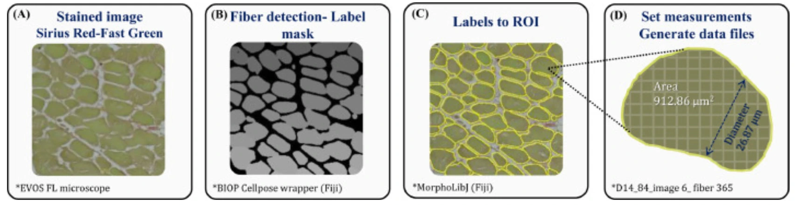

# Muscle Fiber Segmentation with Cellpose and MorphoLibJ (Fiji)

A Fiji macro that segments muscle fibers in histological cross-sections with
[Cellpose](https://github.com/MouseLand/cellpose) (through the
[PTBIOP wrapper](https://github.com/BIOP/ijl-utilities-wrappers)), removes
fibers cut by the image edge with [MorphoLibJ](https://github.com/ijpb/MorphoLibJ),
and measures every fiber (area, fitted ellipse, Feret diameters, shape).

Published in: Dayan J, Goldman N, Waiger D, Melkman-Zehavi T, Halevy O, Uni Z.
*A deep learning-based automated image analysis for histological evaluation of
broiler pectoral muscle.* Poultry Science 2023;102(8):102792.
[doi:10.1016/j.psj.2023.102792](https://doi.org/10.1016/j.psj.2023.102792)



*Workflow figure from Dayan et al. 2023. (A) Picrosirius Red–Fast Green stained
cross-section imaged on an EVOS FL microscope; (B) fiber label mask from the BIOP
Cellpose wrapper; (C) labels converted to ROIs; (D) measurements per fiber
(here: area 912.86 µm², diameter 26.87 µm).*

## Why automate?

Manual measurement of myofibers in stained sections is slow and laborious, which
has limited studies to a few thousand fibers. Existing automated tools were developed
mainly for mouse and human muscle, whose fibers are more uniform than the highly
variable broiler breast muscle. This workflow was validated against manual
measurement on broiler pectoral muscle (Dayan et al. 2023, stage 1: 14-day-old
chicks, v1 macro):

| | Manual (Fiji measuring tool) | Automated (this workflow) |
|---|---|---|
| Time per image | 120 min | 3 min |
| 27 images | 54 h, 17,333 fibers | 1.4 h, 15,881 fibers |
| 84 images | – | 4.2 h, 59,128 fibers |
| Data sets (diameter + area) per hour | 321 | 22,687–26,279 (70–80× more) |
| Mean lesser diameter | 22.86 µm | 23.58 µm (27 images), 22.84 µm (84 images) |
| Coefficient of variation | 33.17% | 31.99% (27 images), 32.21% (84 images) |
| Accuracy rate vs. manual | – | 96.84% (27 images), 99.91% (84 images) |

- **Same accuracy, much faster:** diameter distributions from both methods are
  nearly identical, while the automated run takes minutes instead of hours per image.
- **Larger, more representative samples:** each cross-section is covered almost
  entirely instead of a manually selected subset.
- **Sensitive enough for experiments:** in stage 2 of the paper, 41,562 fibers from
  control and in ovo HMTBa-fed chicks were analysed in under 1 h, and the
  difference in fiber diameter (15.9 vs 15.14 µm) and area (325.99 vs 309.72 µm²)
  was significant.

## Repository layout

| Path | Content |
|---|---|
| `macros/muscle_fiber_segmentation.ijm` | Current macro (v2): batch processing, all parameters in one dialog |
| `legacy/muscle_fiber_seg_cellpose_morpholibj_v1.ijm` | Original macro as used in the 2023 paper, kept unchanged for reproducibility |
| `CHANGELOG.md` | What changed between versions |
| `CITATION.cff` | Citation metadata (GitHub shows a "Cite this repository" button) |
| `docs/workflow_panel.webp` | Workflow figure from the paper |

## Workflow

For every image in the input folder:

1. **Calibration** – reads the pixel size from the image metadata. If the image
   is not calibrated in micrometers, the fallback pixel size is used.
2. **Segmentation** – Cellpose produces a label image (one integer value per fiber).
3. **Edge cleanup** – fibers within *N* pixels of the image edge are removed,
   because they are cut and would bias size measurements.
4. **Measurement** – labels are converted to ROIs and measured with ImageJ.
5. **Quality control** – a flattened image is saved with fiber outlines (yellow)
   and equivalent ellipses with their axes (blue) drawn over the original.

## Requirements

1. **Fiji** – current version from <https://fiji.sc>.
2. **Update sites** (*Help › Update… › Manage update sites*), then restart Fiji:
   - `PTBIOP` – Cellpose wrapper and *Label image to ROIs*
   - `IJPB-plugins` – MorphoLibJ
3. **Cellpose 3 Python environment** (the macro uses the wrapper command
   *Plugins › BIOP › Cellpose/Omnipose › Cellpose …*, which supports
   `cellpose<=3.1.1.1`):

   ```bash
   conda create -n cellpose python=3.10
   conda activate cellpose
   pip install "cellpose==3.1.1.1"
   ```

   For GPU acceleration, install a CUDA build of PyTorch first, following
   <https://pytorch.org/get-started/locally/>. The BIOP wiki has detailed setup
   instructions: <https://wiki-biop.epfl.ch/en/ipa/fiji/update-site>.
   To find the environment folder, run `conda env list`.

### Tested with

Fiji 2.18.0 / ImageJ 1.54p, PTBIOP `ijl-utilities-wrappers` 0.12.1, `LaRoMe` 0.3.2,
MorphoLibJ 1.6.5, cellpose 3.1.1.1 (CPU, Linux), on synthetic test images
(October 2026). Not yet re-validated on real muscle sections against the paper data.

## Usage

1. Put all images to analyse in one folder (one fiber section per image).
2. In Fiji: *Plugins › Macros › Run…* and select `macros/muscle_fiber_segmentation.ijm`
   (or open it in the Script Editor and press *Run*).
3. Fill in the dialog and press *OK*. Progress is printed in the Log window.

### Parameters

| Parameter | Default | Meaning |
|---|---|---|
| Input folder | – | Folder with the images |
| Output folder | – | Where results are written; must differ from the input folder. Existing files with the same name are overwritten |
| File extension | `.tif` | Only files ending with this are processed |
| Cellpose Python environment folder | – | Folder of the conda/venv environment with Cellpose installed |
| Environment type | `conda` | `conda` or `venv`. On macOS/Linux always choose `conda`: the wrapper supports `venv` only on Windows, and with `conda` it simply runs `<environment folder>/bin/python`, so a venv folder works too |
| Cellpose model | `cyto2` | Pretrained model name (`cyto2`, `cyto3`, `cyto`, …) |
| Expected fiber diameter | `150` | Typical fiber diameter in **pixels**; Cellpose rescales images based on it |
| Cytoplasm channel | `0` | `0` = grayscale (use for RGB/H&E); otherwise 1, 2, 3 |
| Nuclei channel | `0` | `0` = none |
| Flow threshold | `0.4` | Cellpose default. Increase to accept more (less regular) shapes |
| Cell probability threshold | `0.0` | Cellpose default. Decrease to grow masks / find fainter fibers |
| Use GPU | on | Adds `--use_gpu`; needs a CUDA-enabled PyTorch in the environment |
| Edge margin | `6` | Fibers with any pixel within this many pixels of the edge are excluded |
| Minimum fiber area | `100` pixels | Smaller objects are discarded. Cellpose labels can contain single stray pixels that would otherwise appear as extra 1-pixel "fibers" |
| Fallback pixel size | `0.151515` µm/pixel | Used when the image has no micrometer calibration. Default = 50 µm / 330 px (6.6 px/µm), the value of the paper's images: EVOS FL Auto, 12 stitched ×60 fields |
| Always use fallback pixel size | off | Ignore image metadata and always use the fallback value |

**Check the pixel size.** The fallback value is correct only for the
microscope/objective/camera used in the paper. For other setups, measure a
stage micrometer or read the value from the acquisition software. The pixel
size actually used for every image is written to `run_log.txt`.

### Outputs (per image, in the output folder)

| File | Content |
|---|---|
| `<name>_results.csv` | One row per fiber (columns below) |
| `<name>_labels.tif` | Label image after edge cleanup (calibrated) |
| `<name>_rois.zip` | Fiber ROIs, open with the ROI Manager |
| `<name>_qc.png` | Original image with outlines and ellipses, for visual checking |
| `run_log.txt` | Parameters, ImageJ version, and per image: pixel size and its source, fiber count, fragments removed |

Columns of `_results.csv` (lengths in µm, areas in µm²):

| Column | Meaning |
|---|---|
| `Label` | `<image>_labels.tif:<ROI name>`; the ROI name contains the Cellpose label ID |
| `Area` | Cross-sectional area |
| `Major`, `Minor`, `Angle` | Axes and angle (degrees) of the best-fitting ellipse (as in the paper) |
| `Feret`, `FeretAngle`, `FeretX`, `FeretY` | Maximum caliper diameter, its angle and start point |
| `MinFeret` | Minimum caliper diameter, the narrowest width of the fiber |
| `Circ.`, `AR`, `Round`, `Solidity` | Shape descriptors: circularity, aspect ratio, roundness, solidity |

Definitions: [ImageJ user guide – Set Measurements](https://imagej.net/ij/docs/guide/146-30.html#sub:Set-Measurements...).
The blue ellipses in the QC image come from MorphoLibJ *Equivalent Ellipse*
and are for visual checking only; the numbers in the CSV come from ImageJ.

## Reproducing the paper

The 2023 results were produced with `legacy/muscle_fiber_seg_cellpose_morpholibj_v1.ijm`,
an older version of the PTBIOP wrapper (*Cellpose Advanced* command, model
`cyto2_omni`) and a fixed scale of 330 px = 50 µm. That command no longer exists
in current wrapper releases. The v2 macro keeps the same processing steps and
default values, but segmentation may not be identical with current Cellpose
versions. See [CHANGELOG.md](CHANGELOG.md) for all differences.

## Troubleshooting

- **"Unrecognized command: Cellpose …"** – the PTBIOP update site is not
  enabled, or Fiji was not restarted after updating.
- **"Cellpose returned no label image"** – wrong environment folder or type
  (on macOS/Linux use `conda`); check the Fiji console (*Window › Console*).
- **Fibers merged or split** – adjust *Expected fiber diameter* first, then the
  flow and probability thresholds. Test on a single image (put it alone in a folder).
- **Areas look wrong by a large factor** – check the pixel size in `run_log.txt`.

## Author

Daniel Waiger – Center for Scientific Imaging, The Robert H. Smith Faculty of
Agriculture, Food and Environment, The Hebrew University of Jerusalem.
Contact: [danielw@savion.huji.ac.il](mailto:danielw@savion.huji.ac.il) ·
image.sc: Daniel_Waiger

Developed for Noam Goldman (Zehava Uni Lab, HUJI).

## License

[MIT](LICENSE). Cellpose, the PTBIOP wrapper and MorphoLibJ are separate
projects with their own licenses; please cite them as well:

- Stringer C, Wang T, Michaelos M, Pachitariu M. Cellpose: a generalist algorithm
  for cellular segmentation. *Nature Methods* 2021;18:100–106.
  [doi:10.1038/s41592-020-01018-x](https://doi.org/10.1038/s41592-020-01018-x)
- Legland D, Arganda-Carreras I, Andrey P. MorphoLibJ: integrated library and
  plugins for mathematical morphology with ImageJ. *Bioinformatics* 2016;32(22):3532–3534.
  [doi:10.1093/bioinformatics/btw413](https://doi.org/10.1093/bioinformatics/btw413)
